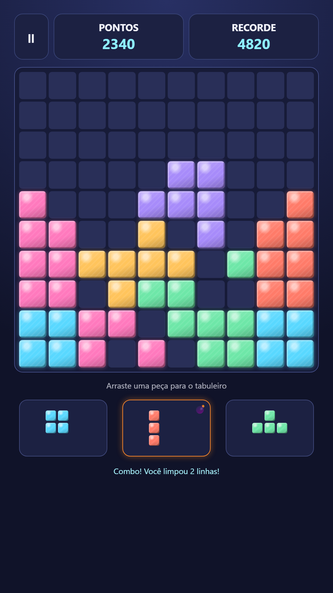
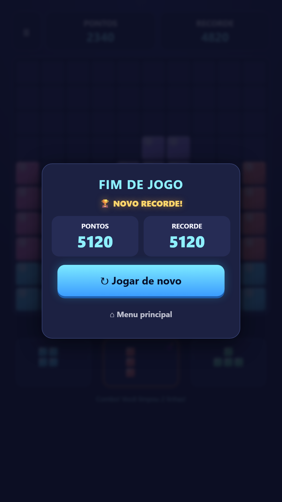

# 🧩 Crazy Block Dash

[](https://github.com/erikmmadsen/crazy-block-dash/actions/workflows/ci.yml)
[](https://github.com/erikmmadsen/crazy-block-dash/actions/workflows/deploy.yml)
[](https://github.com/erikmmadsen/crazy-block-dash/releases)

Quebra-cabeça de blocos colorido e cheio de surpresas. Arraste as peças para o tabuleiro 10×10, complete linhas e colunas, faça combos e use peças especiais malucas!

### 🎮 [Jogar agora no navegador](https://erikmmadsen.github.io/crazy-block-dash/)

Desenvolvido por **Erik Moreira Madsen**.

<p align="center">
  
  
  
  
</p>

## Como jogar
- Arraste as peças para o tabuleiro. A peça aparece acima do dedo para você ver onde vai encaixar.
- Complete uma **linha** ou **coluna** para limpar e ganhar **100 pontos**. Cada bloco encaixado vale **10 pontos**.
- Enquanto você arrasta, as linhas que vão completar ficam com **contorno dourado**.
- Limpe várias linhas de uma vez para fazer um **combo**. O locutor comemora: *Good, Great, Incredible, Unstoppable!*
- **Combo triplo** (3 ou mais linhas):
  - os blocos viram **rubis** ♦️;
  - os personagens comemoram;
  - o **multiplicador** sobe (X2, X3...) e multiplica todos os pontos até o fim da partida.
- Quando nenhuma peça couber mais, o jogo acaba.

### Peças especiais
| | Peça | Efeito |
|---|---|---|
| 💣 | Explosivo | destrói os blocos em volta |
| 💧 | Derrete | derrete um quadrado 2×2 |
| ⏳ | Areia | vira areia e os blocos desabam |
| 🧲 | Ímã | puxa os blocos próximos para cima |
| 🧹 | Limpa tudo | apaga o tabuleiro e dá +300 pontos |

### Modos
- **Clássico**: partida infinita, vale o seu recorde.
- **🗺️ Fases**:
  - 20 fases com objetivos (limpar linhas ou fazer pontos);
  - blocos que já começam no tabuleiro;
  - limite de peças e até 3 ⭐ por fase.
- **🏆 Placar mundial**: ranking pelo Google Play Games (no app Android).

Idiomas: português (Brasil e Portugal), inglês, francês e espanhol.

## Tecnologia
- O jogo inteiro é um único arquivo HTML, CSS e JavaScript: [`BlockBlastMaluco_v2.html`](BlockBlastMaluco_v2.html), sem frameworks.
- **Android**: [Capacitor 8](https://capacitorjs.com/) (API 36), com plugin nativo próprio para o Google Play Games.
- **Web**: GitHub Pages.
- **Sons e personagens**: gerados com Higgsfield.

## Rodar localmente
Requisitos: Node.js 22+. Para o Android, também o Android Studio.

```sh
npm install
npm run site     # monta www/ e site/
npm run check    # verificações automáticas
```

Para jogar no navegador, abra `www/index.html`, ou sirva a pasta `site/` com qualquer servidor estático.

**Android:**
```sh
npm run sync     # copia o jogo para o projeto Android
npm run open     # abre no Android Studio (▶ para instalar no celular)
```

## Estrutura
```
BlockBlastMaluco_v2.html   o jogo (fonte)
sounds/  images/           sons e imagens
android/                   projeto Android (Capacitor)
play-store/                textos da loja, política de privacidade, artes
scripts/                   build e verificações
.github/                   CI/CD, modelos de issue e PR
CHANGELOG.md               histórico de versões
```

## Versões e CI/CD
O jogo segue o [SemVer](https://semver.org/lang/pt-BR/). A versão fica no `package.json` e aparece no menu e no app Android. O histórico está no [CHANGELOG](CHANGELOG.md).

| Quando | Workflow | O que faz |
|---|---|---|
| Pull Request para `main` | **CI** | monta o jogo; verifica JavaScript, sons, imagens, os 5 idiomas, se a versão subiu e o CHANGELOG; gera a prévia do site e o **APK de teste** |
| Merge na `main` | **Deploy** | publica o site no GitHub Pages e cria a **Release `vX.Y.Z`** com o APK (e o `.aab` assinado, se os segredos estiverem configurados) |

### Fluxo de alterações
1. Abrir uma **issue** com o pedido.
2. Criar uma **branch** `feature/<nº>-<resumo>` ou `fix/<nº>-<resumo>`.
3. Fazer a mudança, subir a versão (`npm version patch|minor --no-git-tag-version`) e atualizar o `CHANGELOG.md`.
4. Abrir uma **Pull Request**. A `main` é protegida: precisa do CI passando e da aprovação do Erik.
5. Depois do merge, o site e a Release são publicados automaticamente.

### Segredos opcionais (`.aab` assinado na Release)
Em *Settings › Secrets and variables › Actions*:
- `ANDROID_KEYSTORE_BASE64`: o arquivo `upload-key.jks` em base64;
- `ANDROID_KEYSTORE_PASSWORD`;
- `ANDROID_KEY_ALIAS`;
- `ANDROID_KEY_PASSWORD`.

## Privacidade
Veja a [Política de Privacidade](https://erikmmadsen.github.io/crazy-block-dash/politica-de-privacidade.html).
